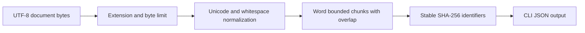

# Document Ingestion Pipeline

A small ingestion component for RAG systems that need predictable inputs before embedding or indexing. It accepts UTF-8 Markdown and plain text bytes, enforces a byte limit, normalizes Unicode and whitespace, and emits bounded overlapping chunks with stable identifiers. It does not read arbitrary filesystem paths in the library API.



## Run

Python 3.10+; runtime uses only the standard library.

```bash
python -m pip install -e '.[test]'
python -m document_ingestion.cli fixtures/payment-timeout.md --chunk-size 24 --overlap 4
python -m pytest -q
```

The default maximum document size is 1 MB. Tune chunk size and overlap for the target model and corpus. This prototype counts whitespace-separated words, not model tokens; production indexing should use the selected model tokenizer and apply access control before ingestion.

## Evaluation

Run `python -m pytest -q`. The tests verify deterministic IDs, overlap bounds, unsupported type rejection, path rejection, invalid UTF-8, empty content, byte limits, and invalid chunk configuration. The saved synthetic incident fixture can be used for a manual CLI run. No throughput benchmark is claimed.
