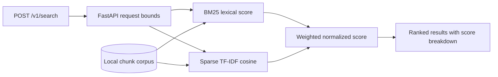

# Hybrid Retrieval API

A local FastAPI service that combines BM25 lexical relevance and sparse TF-IDF cosine similarity. Both score components are returned so ranking decisions can be inspected. The deterministic sparse vectorizer avoids external embedding models, network calls, and paid inference. It is a replaceable baseline, not a semantic embedding model.



## Run

Python 3.10+; the runtime depends on FastAPI and Uvicorn.

```bash
python -m pip install -e '.[test]'
python -m uvicorn hybrid_retrieval.app:app --host 127.0.0.1 --port 8001
```

```bash
curl -sS http://127.0.0.1:8001/v1/search \
  -H 'content-type: application/json' \
  -d '{"query":"payment authorization timeout","top_k":3}'
```

The default corpus is a small synthetic JSONL fixture. For application use, construct `HybridRetriever` with validated chunks and pass it to `create_app`. The API caps query length at 500 characters and `top_k` at 20. Add authentication and tenant-aware document filtering before exposing a real corpus.

## Evaluation

Run `python -m pytest -q`. Tests cover relevance on synthetic queries, explainable score components, empty and unmatched queries, duplicate chunk identifiers, ranking bounds, health, and HTTP validation. Results are deterministic offline checks; no retrieval quality or throughput benchmark is claimed. Sparse TF-IDF cannot match semantic embeddings for paraphrases.
